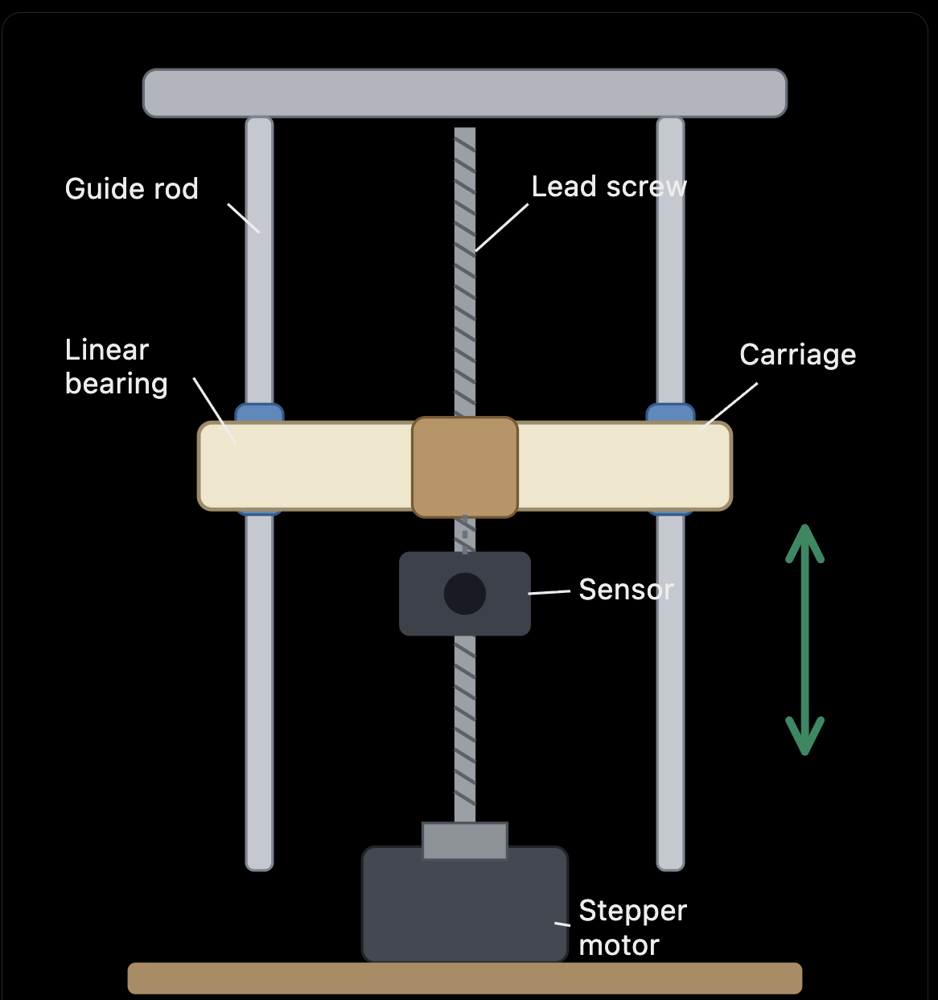
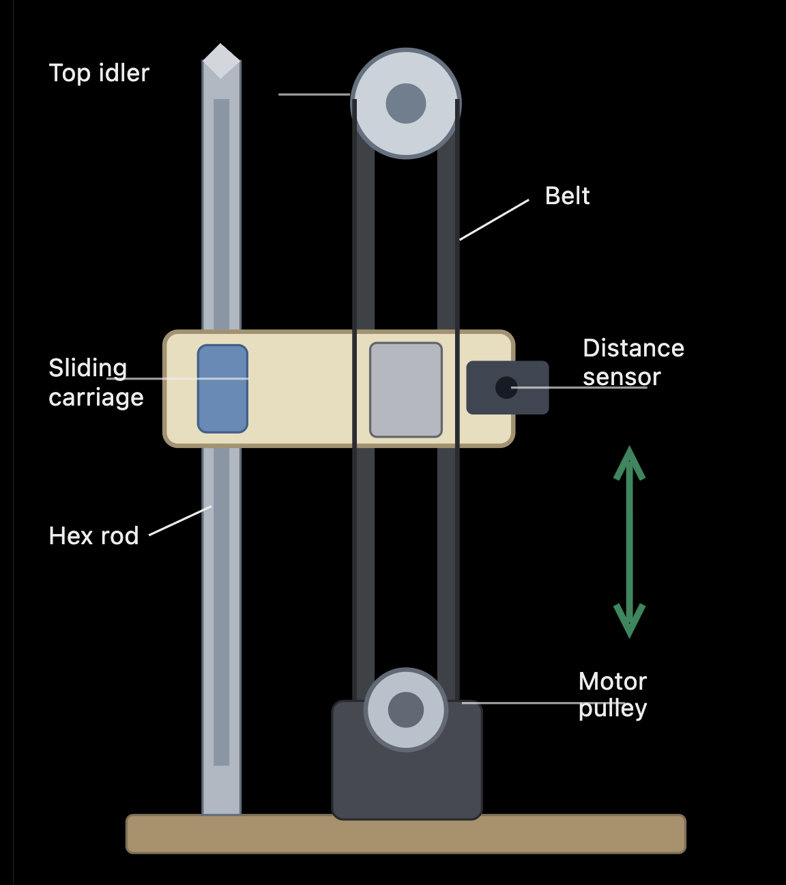
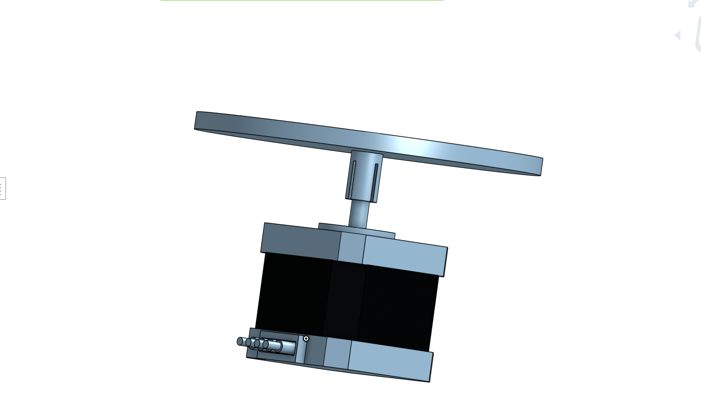
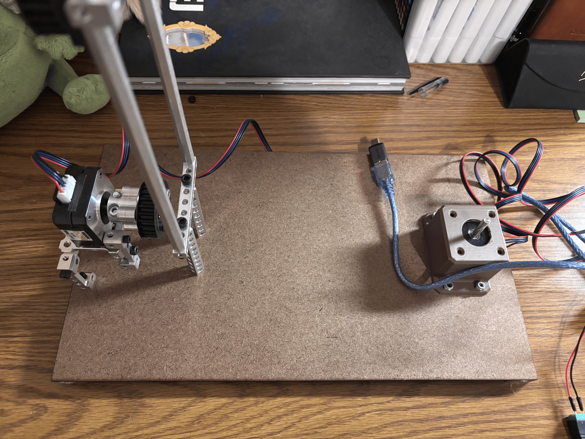

# Building a DIY Arduino-Based 3D Scanner

I am so glad I could do this project over a span of many days. I have learnt a lot everyday, and I have many great resources around me to make this task very fruitful and joyful.

---

## How We Started

When our team first started this project, we wanted to build something that combined mechanical engineering, programming, and 3D design. We knew our task was about using the stepper motors, so we decided to create a DIY 3D scanner using Arduino and many motors and the materials available in our robotics lab.

Wachi had some inspiration after watching a youtube video on the same concept. His idea was to build a machine that could measure a physical object from different angles and heights, eventually allowing us to reconstruct its shape as a digital 3D model. He wanted the **first motor** to rotate a circular platform holding the object. The platform would turn through **360 degrees so the sensor could collect measurements from different angles**. He then wanted the **second motor** to control the vertical movement of a Sharp infrared distance sensor. By moving the sensor up and down, we could measure different sections of the object.

In theory, combining these movements would allow us to collect enough measurements to begin reconstructing a three-dimensional model.

However, we quickly realized that designing the system was much easier than actually building it. It was a matter of time before we met a lot of difficulties along the way.

### Our Initial Design

```text
       Sharp IR Sensor
              |
       Vertical Movement
              |
        Stepper Motor 2

              +

      Rotating Platform
              |
       Stepper Motor 1
              |
       360° Rotation
```

## Our Original Plan: Using a Shaft

We initially took inspiration from existing DIY 3D scanners that used a threaded shaft to move a sensor vertically. That mechanism seemed relatively straightforward. A stepper motor would rotate a threaded lead screw, and a nut connected to the sensor carriage would travel along the screw. Two smooth guide rods would prevent the carriage from rotating or becoming unstable.

**Stepper Motor → Lead Screw → Moving Carriage → IR Sensor**



The above picture was what we tried to aim for, yet **when we checked the materials available in our robotics lab**, we encountered our **FIRST MAJOR PROBLEM**.

**We did not have a T8 lead screw or two smooth 8 mm guide rods.**

We did, however, have a long hexagonal metal rod that was approximately 6–7 mm thick.

At first, we wondered whether we could simply substitute this rod for the threaded shaft. After exploring how lead screws work, we realized that this would not be possible without modifying the mechanism. The hexagonal rod had no threads, meaning it could not move a nut up and down through rotation.

This was frustrating because it meant our original mechanical design would not work with the components we had. And so instead of buying an entirely new set of materials, we decided to investigate another approach - belts.

## Changing Our Design: From Shaft to Belt

After realizing that our original mechanism would not be practical, we began exploring how belts and pulleys could produce vertical movement. We wanted to achieve the same result as the lead screw system: moving the Sharp IR sensor up and down while keeping it stable.

Our revised concept used a timing belt driven by two stepper motors - one on top and the other down the bottom.

The motor would rotate a pulley at the bottom of the structure. The belt would run around this pulley and another pulley at the top, forming a continuous loop.

When the motor rotated, the belt would move. A carriage attached to one side of the belt would then travel vertically (**this we would need to CAD in future classes**) The Sharp IR sensor would be secured to this carriage rather than directly attached to the belt.


### Design Documentation

**Belt and Pulley Mechanism**




### Design Reflection

This was actually very rewarding. We miscalculated the first time, and we only have one motor running right now. Next class, we would need to add another motor to make the top part spin, so we could have a spinning belt. The design is pretty good and cohesive according to plan. We now need to upgrade some parts of our design and make it more stable. We need to CAD out the sharp structure connection part onto the stepper motor's belt so it can move up and down.

Yet, here is just a video to show how we were able to make one connection part work! This would mean that we could replicate this into two or even 3!

VIDEO

---

## Designing the Rotating Platform in Onshape

While working on the vertical mechanism, we also spent a significant amount of time developing the rotating platform. This part was especially important because the object needs to remain stable while the motor rotates it through 360 degrees.

We originally thought that creating a circular platform would be one of the easiest parts of the project.

However, the connection between the platform and the stepper motor turned out to be much more complicated than we expected. It would often times bend and not stick properly, causing us to use many prototypes and making the radius a little larger every time.



The above is our final design with the stepper motor on!

### Some Problems Regarding our first prototype.

Wachi took a long time first testing the multimeter, and after many classes, the wiring of the stepper motors were still not fixed. I ended up helping him, and a crucial part he forgot a little bit about was how the stepper motors had to match up together in order to function properly. With four nodes of **red, green, blue, and black**, each node is correspondent with another, and matching is very important.

Hence, here is just a video to show our current progress with the motors and how they are spinning already!


## What We Have Understood, What We Have Learnt, and What We Have Used.


### Parts and Components We Worked With

| Component | Purpose |
|---|---|
| Arduino Uno R3 | Controls the stepper motors |
| Stepper Motor 1 | Rotates the object holder |
| Stepper Motor 2 | Drives the vertical movement system |
| Circular Platform | Holds the object during scanning |
| Sharp IR Sensor | Measures distance to the object |
| Timing Belt | Transfers motor rotation into vertical movement |
| Pulleys | Drive and guide the timing belt |
| Hexagonal Rod | Potential guide for the sensor carriage |
| Custom CAD Parts | Support and connect mechanical components |
| Base Structure | Supports the overall scanner |

### Robotics Lab

A huge thanks to Dr. Dzula for opening the robotics lab! We really got into working with the laser cutter, and many components listed above was from the robotics lab. The many M4 screws, M3 screws, dangling parts, connection metal pieces, small screwdrivers, rulers, laser cutter, 3D SCANNER, arduino, the belts, the hot glue gun, and the long hexagonal poles were all from the Robotics lab.

**Our Physical Prototype**



---

## Arduino Programming and Motor Testing

Another major part of our project involved connecting the stepper motors to the Arduino and writing code to control them. We used an Arduino Uno R3 and experimented with different motor setups. Our goal was to independently control the motor responsible for the rotating platform and the motor responsible for the vertical movement mechanism. However, at this stage, our Arduino program is still a very early prototype.

### What Our Current Code Does

Our current program is designed mainly to test whether the motors can rotate continuously.

We have experimented with running two stepper motors at different speeds.

One motor is intended for the rotating object platform, while the other is intended for the vertical belt mechanism.

**At the moment, our code simply keeps the motors spinning. It does not yet perform an automated 3D scanning sequence.**

The program is useful for checking:

- Whether the Arduino can communicate with the motor control hardware.
- Whether both motors respond to the code.
- Whether the motors can rotate continuously.
- How changing the programmed motor speed affects their movement.
- Whether our electronic connections work as expected.

This testing stage is important because we need to understand how the motors behave before connecting them to a complete scanning mechanism.

### Our Current Motor Setup

```text
Arduino Uno R3
      |
      |---- Motor Control 1
      |           |
      |      Stepper Motor 1
      |           |
      |      Continuous Rotation
      |
      |---- Motor Control 2
                  |
             Stepper Motor 2
                  |
             Continuous Rotation
```

The motors are being tested as independent components. We have not yet completed the programming needed to synchronize their movements with the IR sensor.

### What Our Code Cannot Do Yet

The current version does not:

1. Automatically stop the rotating platform after a precise 360-degree scanning cycle.
2. Move the IR sensor upward by a specific measured distance after each rotation.
3. Read and record Sharp IR sensor measurements as part of a coordinated scan.
4. Synchronize the sensor measurements with the platform's angular position.
5. Convert collected sensor data into a complete 3D model.

These are functions we hope to add as the project develops.

### Our Next Programming Goal

Eventually, we want the Arduino to follow a sequence similar to this:

```text
START
  |
  v
Set Sensor to Initial Height
  |
  v
Rotate Platform
  |
  v
Collect IR Distance Measurements
  |
  v
Complete One 360-Degree Rotation
  |
  v
Move Sensor Up by a Small Increment
  |
  v
Repeat Until Scanning Is Complete
  |
  v
Save Measurement Data
  |
  v
Process Data into a 3D Model
```


## AI Usage and Our Own Contributions

We used ChatGPT throughout parts of our project as a resource for learning about mechanical design and exploring possible solutions.

We want to be transparent about its role.

ChatGPT helped us understand how different vertical movement mechanisms work, including lead screws, linear guide rods, timing belts, pulleys, and moving carriages.

It also provided conceptual diagrams and explanations that inspired some of our structural ideas.

One particularly useful contribution was helping us explore the possibility of replacing the original shaft-driven mechanism with a belt-driven system when we realized that we did not have the required materials.

AI helped us consider alternatives and understand the engineering principles behind them.

However, there is a significant difference between receiving an idea and implementing it in a physical machine.

The practical development of the project was carried out by our team.

We were responsible for designing and repeatedly modifying our CAD models, experimenting with motor configurations, connecting the Arduino and motors, developing and testing the Arduino code, and debugging the system.

We also independently used the robotics lab and its equipment, including the laser cutter, to create and modify components for our prototypes.

The decisions about which parts to use, how to assemble them, and how to respond when something did not work were made by our team.

Although ChatGPT provided useful inspiration, it could not determine whether a particular physical assembly would actually work without real testing.

We had to make those judgments ourselves through experimentation.

**Overall, AI supported our understanding and brainstorming, while the hands-on design, programming, fabrication, troubleshooting, and engineering decisions were completed by our team.**

We see AI as a useful tool for learning engineering concepts, but not as a replacement for the work required to build and debug a real system.

---

## Final Thoughts at this Juncture of Time

Looking back at our work so far, this project has been more complicated than we expected.

We began with a relatively straightforward idea: use two motors and a distance sensor to create a 3D scanner.

However, once we started working with actual components, we encountered problems involving mechanical stability, material availability, motor configurations, and electronic connections.

Our original shaft-driven design had to be reconsidered because we lacked the necessary parts. Our rotating platform required repeated CAD redesigns because several versions were unstable when mounted to the motor.

Even our Arduino code remains a basic testing program rather than a complete scanning system.

Despite these challenges, we have made progress in understanding how the components need to work together.

We have learned that engineering is not just about knowing how something should work in theory. It is also about making adjustments when the theory meets physical limitations.

For us, one of the most valuable lessons has been learning to approach problems through experimentation rather than expecting the first design to work perfectly.

**Our scanner is not finished yet, but the process of designing, testing, debugging, and improving it has already taught us a great deal about engineering.**
