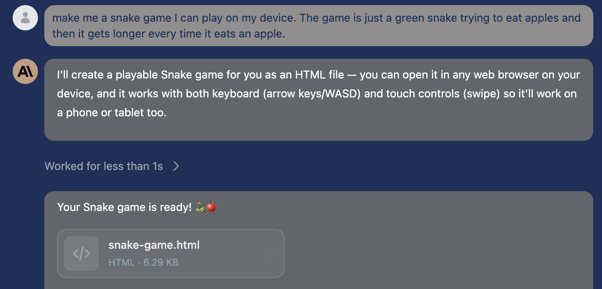
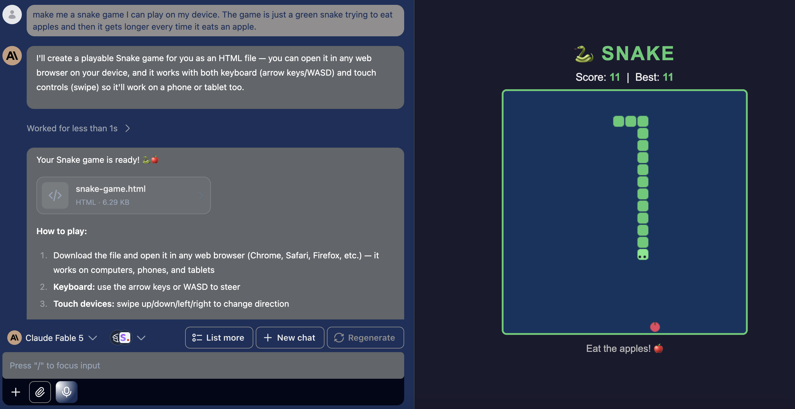
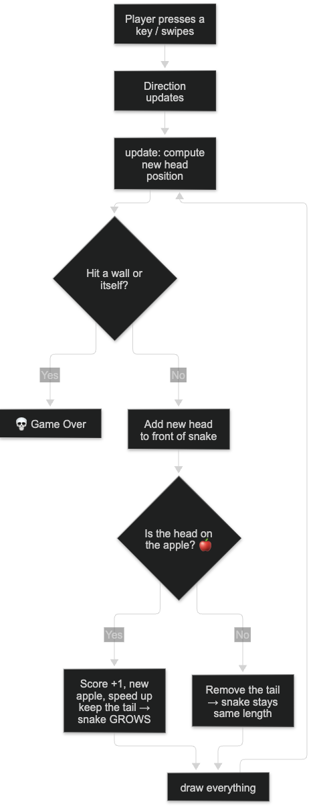
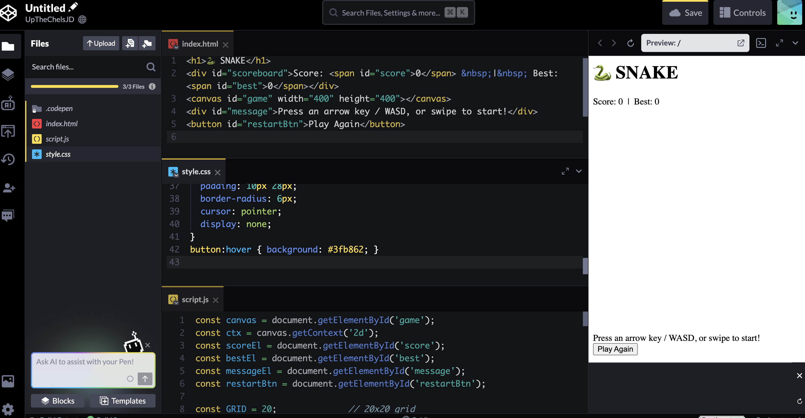
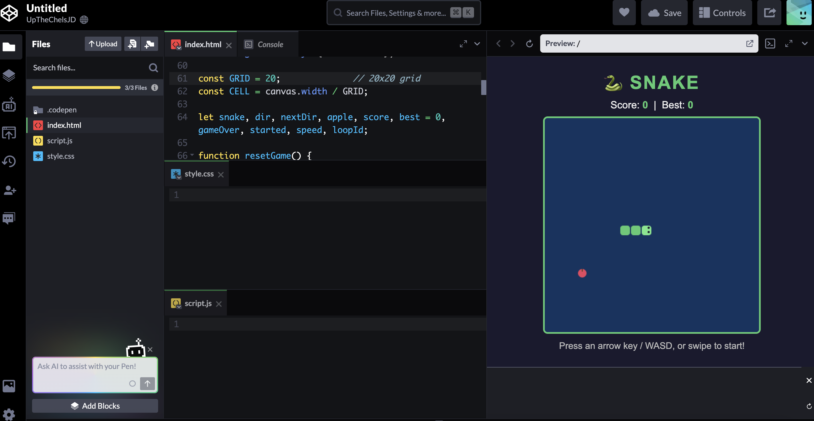

# One-Shot AI Snake Game

My project is just a classic Snake game — a green snake eats apples and grows longer with each one — generated by an AI assistant from a **single prompt** ("one-shot"), then studied and documented by me as a learning project. I utilized the AI assistant from my own school, **WebbGPT.AI**. This is a very primitive step in coding, yet, forme, it acts as a foundation for later studies in software.

## How to Play it

As hard as the code seems, playing the game is quite easy:

Open `snake-game.html` in any web browser (desktop or mobile).

- **Keyboard:** Arrow keys or WASD
- **Touch:** Swipe up / down / left / right
- Game over if you hit a wall or yourself — press **Play Again** to restart

## But More Importantly... How was this project made?

This project is an experiment in **one-shot AI code generation**: I asked an AI assistant to build a complete, playable Snake game in one request, with no follow-up code changes. The AI produced a single self-contained HTML file (HTML + CSS + JavaScript, ~220 lines) that worked on the first try. Just to be clear, the game code **was** written by **AI**, not by me. My work in this project was only to **prompt**, **test**,  **understand** the code, and **document** it here.

## My own progress log

**Step 1 — The one-shot prompt.** I asked the AI for "a green snake trying to eat apples that gets longer every time it eats an apple." After a few seconds, it gave me a a complete `snake-game.html` file with swipe + keyboard controls, scoring, a best-score tracker, and increasing speed.



**Step 2 — Played and tested it.** I, of course, had to play the classic game in order to verify the code and if it was working on my laptop!



**Step 3 — Studied the game logic.** Because I could not code hundreds of lines of code in less than seconds, I walked through the code with WebbGPT and actually surprisingly learnt a lot:

1. The HTML, or the skeleton

```html
<canvas id="game" width="400" height="400"></canvas>
```

The `<canvas>` is like a blank digital whiteboard, which is 400×400 pixels. It can be changed, and JavaScript draws the snake and apple onto it, erases it, and redraws it many times per second. It is like a flipbook animation!

The other body elements are the title, the scoreboard, a message line, and a hidden "Play Again" button, as presented here:

```html
<h1>🐍 SNAKE</h1>
<div id="scoreboard">Score: <span id="score">0</span> &nbsp;|&nbsp; Best: <span id="best">0</span></div>
<canvas id="game" width="400" height="400"></canvas>
<div id="message">Press an arrow key / WASD, or swipe to start!</div>
<button id="restartBtn">Play Again</button>
```

2. The CSS — the look

The style.css part is the `<style>` block. Colors and positions are changed here, and there are a few key parts:

```css
body {
  background: #1a1a2e;      /* dark navy page */
  display: flex;             /* center everything */
  flex-direction: column;
  align-items: center;
  justify-content: center;
  touch-action: none;        /* stops swipes from scrolling the page */
}
canvas {
  background: #0f3460;       /* the board color */
  border: 3px solid #4ecb71; /* green frame */
  max-width: 95vw;           /* shrink to fit small screens */
  max-height: 70vh;
}
```

For example, from these lines, the snake-green `#4ecb71` is reused for the title, border, button, and score numbers so the theme matches.

3. An interesting point for a very primitive snake game: the snake is just a list of squares

Unlike ones you play on Google, this **AI-one-shot** game is much more primitive. The snake actually are just squares that appear and then disappear. The board is an invisible **20×20 grid**. The snake, after all, is just an array (list) of grid coordinates. If the snake eats the apple, the head and tail square both stay. If it moves in any other way, a new block is formed ahead of it and the tail is deleted. For example:

```javascript
const GRID = 20;
const CELL = canvas.width / GRID;

snake = [{x: 9, y: 10}, {x: 8, y: 10}, {x: 7, y: 10}];  // 3-square snake
dir = {x: 1, y: 0};   // moving right (x increases by 1 each step)
```

Another interesting point I learnt was that on a canvas page, the y value gets **bigger going down** — the opposite of any math class, whether HPC or Calc!

4. The game loop — the actual core

```javascript
function gameLoop() {
  if (gameOver) return;
  update();                          // move the snake, check collisions
  draw();                            // repaint the picture
  loopId = setTimeout(gameLoop, speed);  // do it again after speed ms
}
```

This runs every `speed` milliseconds (starting at 150 ms ≈ 6–7 moves per second, and getting faster with each apple). The full flow of one game is as follows:




5. Collision detection and Random apple placement

```javascript
// Wall: did the head leave the 0–19 grid?
if (head.x < 0 || head.x >= GRID || head.y < 0 || head.y >= GRID) return endGame();

// Self: does any body square match the head's position?
if (snake.some(s => s.x === head.x && s.y === head.y)) return endGame();
```

```javascript
function placeApple() {
  while (true) {
    apple = { x: Math.floor(Math.random() * GRID), y: Math.floor(Math.random() * GRID) };
    if (!snake.some(s => s.x === apple.x && s.y === apple.y)) break;
  }
}
```

Interestingly here, I learnt that collision detection uses `Array.some()` to compare the head against walls and body segments. It works with apple placement, in which `Math.random()` gives a decimal between 0 and 1; × 20 and rounded down = a random grid square (0–19), and is very important with the snake's scoring system.

**Step 4 — After learning the code, I started to learn the differences between the languages** I Learnt what the "boring" lines of `<!DOCTYPE html>` do, how important format was by using `<style.css>`, and eventually going to the real Javascript panel. I then eventually got to the tool of CodePen, and I explored it by inputting my AI-generated code into the website.



Yet I actually ran into a big **challenge, or a little bug.** I could not have my preview of the game no matter how hard I tried to refresh or edit by CSS or JavaScript page. Eventually, I wrote everything in the `HTML` section, something **I also didn't previously knew was possible**. And so after multiple tries I finally got it to work. I inquired my AI assistant with the problem, and even it didn't know why the CSS or JS pages fell. It said the bug may have been because of **preprocessor setting, disconnected preview, or even wrong paste targets**.



**Step 5 — I definitely built above understanding and actually explored tooling.** But really just by a little...

I just played with speed, colour of the snake, and the size of the canvas! It was rewarding to see immediate changes!

<video style="width:100%; max-width:700px;" controls>
  <source src="../../videos/67.mp4" type="video/mp4">
</video>

<video style="width:100%; max-width:700px;" controls>
  <source src="../../videos/671.mp4" type="video/mp4">
</video>

<video style="width:100%; max-width:700px;" controls>
  <source src="../../videos/6767.mp4" type="video/mp4">
</video>

## Conclusion

Once again, AI has not let me down. I have one-shotted this to work perfectly, and this is a very good intial development of my key important software projects we are going to creat in the future! I hope I really have fun and dial in into the future courses!

