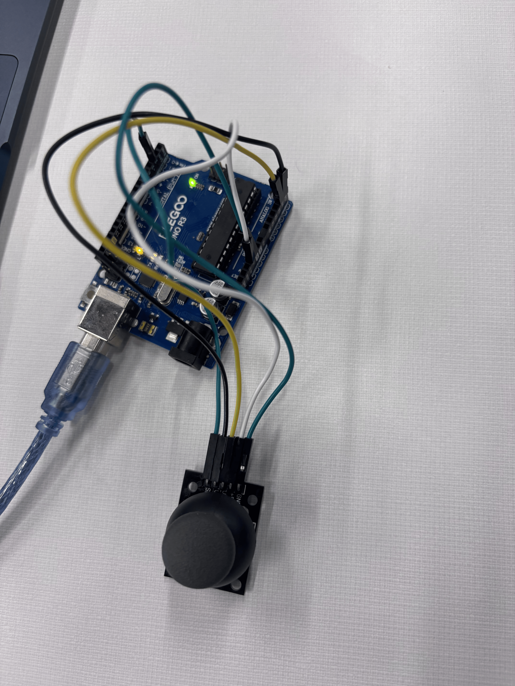
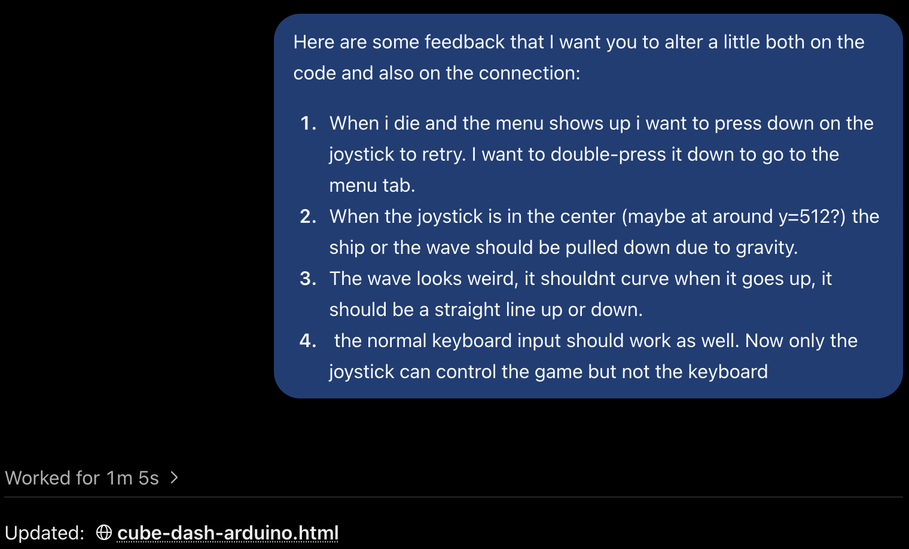

# Arduino Joystick Video Game Controller

## My Idea

For this project, I wanted to use a physical joystick to control a video game on my computer. Whether it was my snake game or Steven's geometry game, I wanted to move the joystick around to control the character **Up, Down, Left or Right**, and pressing it down would act as a button.

I initially worked on connecting the joystick to a Geometry Dash-style game for Steven Shi. Later, I chose my own Snake Game as a practice for myself for the project. Snake has four clear directions, which made the connection between the joystick and the game easier to understand and test.

## My Circuit and Arduino Code

First, before the connection between my game and the controller, I would have to first connect my joystick. My Arduino code uses these connections:

| Joystick Signal | Arduino Pin |
|---|---|
| VRx | A4 |
| VRy | A5 |
| SW | Digital pin 2 |



The Arduino reads the joystick’s position and sends words to the computer through the USB serial connection at 9600 baud.

<video style="width:100%; max-width:700px;" controls>
  <source src="../../videos/3434.mp4" type="video/mp4">
</video>

<video style="width:100%; max-width:700px;" controls>
  <source src="../../videos/4545.mp4" type="video/mp4">
</video>

For example, this section detects vertical movement:

```cpp
if (y > 550) {
  Serial.println("UP");
}
else if (y < 500) {
  Serial.println("DOWN");
}
```

The horizontal movement follows the same idea, sending `LEFT` or `RIGHT`. Values between 500 and 550 do not send a direction for that axis, creating a small neutral zone. **Actually here, Steven and I had a little bit of a confusion with the code. When we tried moving the joystick to the left, the serial monitor would write `RIGHT` and vice versa**.

**Here, we finished the troubleshooting just by changing the two directions around inside the code, so that the direction would correctly work.**

After fixing this small part, I used `INPUT_PULLUP` for the joystick button, so pressing it produces a `LOW` reading:

```cpp
if (button == LOW) {
  Serial.print(" | BUTTON PRESSED");
}
```

## How I Consulted AI

I gave ChatGPT my Arduino code and my existing Snake HTML file. I explained the behavior I wanted: the joystick should control the snake’s direction, and pressing the joystick after dying should let me play again.

ChatGPT modified the HTML to add a **Connect Arduino** button and read the messages sent by my Arduino. It also kept the keyboard and swipe controls working.

The browser connection and serial-reading code were AI-assisted. My contribution was choosing the project, providing my existing code and game, and specifying how I wanted the controls to behave. I also used AI to help organize this documentation.

## Troubleshooting and Execution

One issue identified during the AI-assisted review was that my direction messages use `Serial.println()`, but my button message uses `Serial.print()`. This means the button message does not end with a new line.

Instead of requiring me to change the Arduino code, ChatGPT adjusted the HTML to recognize complete commands even when messages arrive joined together or split into separate pieces.

Another issue was that holding the button sends repeated messages. The HTML uses a gap between button messages to estimate when a new press occurs, helping prevent repeated resets.

ChatGPT ran simulated checks for direction changes, button presses, and connection handling. These checks did not prove that my physical controller worked, so hardware testing was still necessary.

### My Own Testing

- **What I tried:** Personally, I understood the mechanical part a lot better than before. I understood more about where the pins go and how to work with an existing code to make it less sensitive and more punchy. I learnt also the `low` and the `high` of a status of a pin getting pressed down
- **What happened:** Actually, for Steven Shi's final model, he at first didn't have a lot of stuff ready. He had a few game modes: jump, spider, zigzag, and ship. For the ship, it didn't follow the rules of gravity. For the spider, he wanted to control the spider with up and down, **not with the press down button**. He wanted the press down button to be the one that could press **restart** or **back-to-menu**. This made the first few attempts not work, so we troubleshooted step by step by asking AI.



We eventually got his to work as well, and it was very great to see the fruitfulness of the project.

- **What happened afterward:** Here is the final result of my own snake game:

<video style="width:100%; max-width:700px;" controls>
  <source src="../../videos/9898.mp4" type="video/mp4">
</video>

## Managing the Project

Switching to Snake reduced the number of controls I needed to handle and gave me a smaller prototype to work toward. My priorities were connecting the Arduino, testing the four directions, and checking the retry button.

## My Reflection

Overall, it was a great fun few days going over the software part of the project. The part I found most interesting was troubleshooting the code, because it was very fruitful to see the feedback we got from AI and then use it to build off the current model. I felt really proud when both Steven and I finished the dash game and also my snake game together in a span of two days.

In general, this project showed me that getting code from AI is only one part of making a prototype. I still need to understand what the code is supposed to do, test it with my hardware, and describe problems clearly when something goes wrong.
